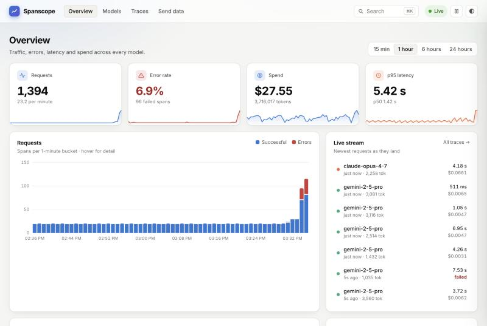
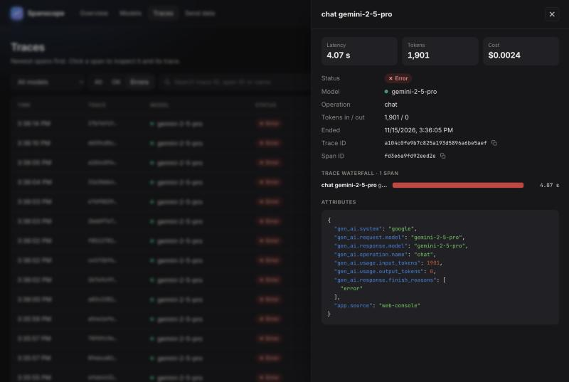

# Spanscope

**Latency, errors and cost for your LLM apps, span by span.**

Spanscope is self-hosted observability for LLM applications. It ingests
OpenTelemetry GenAI traces, shows latency, errors and cost per model in a live
web app, and can store everything in ClickHouse. A companion Python pipeline
demonstrates tail sampling, evals, drift detection and alerting.

[](https://github.com/PrithviHL/Spanscope-LLM-observability-dashboard/actions/workflows/ci.yml)

**[▶ Live demo](https://spanscope-llm-observability-dashboard.onrender.com/)**: no
sign-up needed. It runs on Render's free plan, so the first visit may take up to
a minute while it wakes.



## Try it in 30 seconds

1. Open the [live demo](https://spanscope-llm-observability-dashboard.onrender.com/).
2. Press **⚡ Simulate an incident**.
3. Watch requests spike with errors, the error rate turn red and p95 latency
   jump, then click a failed call in the **Live stream** to inspect it.

The demo receives synthetic traffic; see the [user guide](docs/user-guide.md).

## Features

- **Live overview**: requests, error rate, spend and p95 latency with trend
  lines; requests and latency charts; cost by model; a live stream of the
  newest calls. Refreshes every 5 seconds.
- **Trace explorer**: filter by model and status, search by ID, and open any
  call to see its timing, tokens, cost, trace waterfall and attributes.
- **Model comparison**: sortable per-model table with error rate, tokens, cost
  share and p50/p95/p99 latency.
- **OpenTelemetry ingest**: point any OTel SDK at `/v1/traces` (OTLP/HTTP JSON),
  or post flat JSON spans to `/trace`.
- **Incident simulation and test data** from the browser.
- **Command palette** (⌘K / Ctrl+K), keyboard shortcuts, light and dark themes,
  phone layout, and reduced-motion support.
- **Optional ClickHouse storage**: persistent history and SQL analytics, with CI
  checking it returns the same numbers as the in-memory default.
- **Optional Sign in with GitHub** with personal ingest keys, stateless (no user
  database). Off on the public demo so anyone can try everything.



## What's inside

| Directory | What it is | Stack |
|---|---|---|
| [`dashboard/`](dashboard/) | Ingest server, storage (in memory or ClickHouse), JSON API, optional GitHub sign-in, and the web app | Node.js 20+, TypeScript, Hono; vanilla JS and SVG front end |
| [`pipeline/`](pipeline/) | Tail sampler, eval spans (faithfulness, toxicity, PII), PSI drift detector and alerting, with a demo that catches an injected PII leak | Python 3.9+, standard library only |
| [`docs/`](docs/) | Guides, architecture, API reference, design decisions and the original brief | Markdown |

## Quick start

**Web app** (needs Node.js 20 or newer):

```bash
cd dashboard
npm install
npm run serve
```

Open http://localhost:8011. It starts with an hour of synthetic traffic. To
send your own, use the **Send data** page or point an OpenTelemetry SDK at
`http://localhost:8011/v1/traces` with `OTEL_EXPORTER_OTLP_TRACES_PROTOCOL=http/json`.

**With ClickHouse** (needs Docker Desktop), from the repository root:

```bash
docker compose up -d
```

```bash
cd dashboard && STORAGE=clickhouse npm run serve
```

See the [ClickHouse guide](docs/clickhouse.md).

**Pipeline demo** (needs Python 3.9 or newer, no packages):

```bash
cd pipeline
python3 -m llm_obs
```

## Deploy

The repository includes a Render Blueprint ([`render.yaml`](render.yaml)): in
Render choose **New → Blueprint**, pick this repository and deploy. It runs in
public demo mode (no clearing data, per-visitor rate limit, background
traffic). See the [deployment guide](docs/deployment.md).

## Development

Run every check before opening a pull request. CI runs the same commands, plus
ClickHouse integration tests against a real ClickHouse.

```bash
cd dashboard && npm run check
```

```bash
cd pipeline && python3 -m unittest discover -s tests
```

See [CONTRIBUTING.md](CONTRIBUTING.md) for setup, conventions and the release
process.

## Documentation

| Document | For |
|---|---|
| [User guide](docs/user-guide.md) | Using the web app: pages, incident simulation, shortcuts |
| [Deployment](docs/deployment.md) | Render setup, demo settings, enabling sign-in, troubleshooting |
| [ClickHouse](docs/clickhouse.md) | Running with ClickHouse, example SQL, table design |
| [Architecture](docs/architecture.md) | How the pieces fit, and how they map to the target production stack |
| [HTTP API](docs/api.md) | Every endpoint, payload and status code, including sign-in |
| [Design decisions](docs/decisions.md) | Why things are built the way they are |
| [Dashboard README](dashboard/README.md) | Configuration, scripts, source layout |
| [Pipeline README](pipeline/README.md) | Demo options and modules |
| [Design brief](docs/design/capstone-spec.md) and [rubric](docs/design/assessment-rubric.md) | The original target specification |
| [Changelog](CHANGELOG.md) | What changed in each version |

## Project status

A working, tested prototype: the ingest server, web app, ClickHouse storage,
optional sign-in and the pipeline all run, with 58 TypeScript tests, 4
ClickHouse integration tests and 15 Python tests in CI. Not built yet from the
design brief: running the pipeline's evals and alerts on ingested data,
model-based eval jobs, Alertmanager integration, and per-user data separation.
[docs/architecture.md](docs/architecture.md#target-production-architecture)
shows what's a stand-in and what's next.

Without sign-in enabled, anyone who can reach the server can send it data, so
self-hosted copies should run on localhost or a trusted network, or turn on
sign-in.
