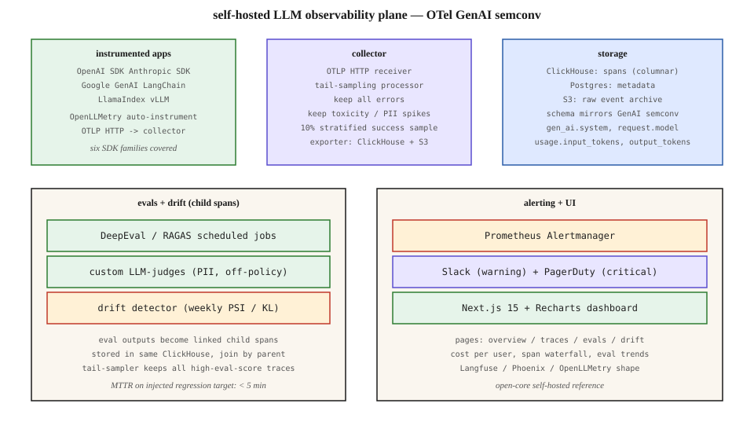

# Architecture

This repository has two runnable parts. They share the same span schema, the
[OpenTelemetry GenAI semantic conventions](https://opentelemetry.io/docs/specs/semconv/gen-ai/),
but they don't call each other yet.

```text
 your LLM app ──OTLP/HTTP JSON──►┐
 curl / web app "Send data" ────►│  dashboard/  (Node.js, Hono)
                                 │  ┌──────────────────────────────────────────┐
                                 └─►│ POST /trace, /v1/traces                  │
                                    │   otlp.ts → normalise.ts → store.ts      │
                                    │   (validate)              (ring buffer,  │
                                    │                            newest 10k)   │
                                    │                               │          │
                                    │   analytics.ts / rollup.ts ◄──┘          │
                                    │        │                                 │
                                    │   GET /api/* ──► public/ web app         │
                                    └──────────────────────────────────────────┘

 pipeline/  (Python, stdlib)
   simulate ─► evals (child spans) ─► TailSampler ─► SpanStore ─► alerts
        └──────────────► prompt fingerprints ─► PSI drift
```

## Dashboard (`dashboard/`)

**Ingest.** `POST /trace` and `POST /v1/traces` accept flat spans or an OTLP/HTTP
JSON export request. `otlp.ts` flattens the OTLP shape and decodes typed
attribute values. `normalise.ts` validates every span: the required GenAI
attributes, sane timestamps and non-negative whole-number token counts. It also
fixes up IDs. Invalid spans are counted, never stored. Request bodies are capped
at 5 MB.

**Storage.** Routes talk to a `SpanRepository` (`repository.ts`), which has
two implementations, picked with `STORAGE`:

- `memory` (default): `MemoryRepository` wraps `ObservabilityStore`, which keeps
  the newest `BUFFER_CAPACITY` spans (default 10,000) in a `RingBuffer`. Memory
  is bounded, the oldest spans are evicted first, and nothing survives a
  restart. The public demo uses this.
- `clickhouse`: `ClickHouseRepository` (`clickhouse.ts`) stores spans in a
  ClickHouse `MergeTree` table ordered by end time, partitioned by day, with a
  TTL (`CLICKHOUSE_TTL_DAYS`, default 30) and a bloom-filter index on
  `trace_id`. Model, latency and cost are computed once at ingest and stored as
  columns; the full attribute map is kept as compressed JSON. Data survives
  restarts and isn't limited to 10,000 spans.

**Query.** With `memory`, `analytics.ts` computes the window summary, 60 time
buckets (count, errors, cost, p50/p95) and filtered, paginated span lists, and
`rollup.ts` produces per-model p50/p95/p99 latency, error and token counts and
cost, all by scanning the in-memory snapshot. With `clickhouse`, the same
results come from SQL (`count`, `sumIf`, `quantileExactInclusive`, `intDiv`
time buckets) run inside ClickHouse. `quantileExactInclusive` uses the same
interpolation as the in-memory `percentile()`, and an integration test checks
that both backends return identical numbers for the same spans. Cost uses the
list prices in `pricing.ts`.

The ClickHouse client (`ClickHouseClient`) uses the HTTP interface with plain
`fetch`, so there is no driver dependency. User input always travels as bound
query parameters (`{name:Type}`), never as SQL text.

**Web app.** `public/` is a dependency-free single-page app (hash routing, ES
modules, hand-written SVG charts). It polls the JSON API every 5 seconds. See
[`api.md`](api.md).

## Pipeline (`pipeline/`)

Python reference implementations of the processing stages that would run
behind the collector in production:

| Stage | Module | Behaviour |
|---|---|---|
| Evals | `evals.py` | Faithfulness, toxicity and PII-leak scores, written as `eval` child spans of each LLM span |
| Tail sampling | `sampler.py` | Keeps 100% of errored, toxic or PII-flagged traces, plus a random share of the rest |
| Storage | `store.py` | In-memory spans with per-user and per-model counts and cost |
| Drift | `drift.py` | PSI between baseline and current prompt-bucket distributions; above 0.2 counts as drift |
| Alerting | `alerts.py` | Fires on any PII-leak or toxicity score above threshold |

The demo (`python -m llm_obs`) injects a 1% PII-leak regression and shows the
alert firing.

## Target production architecture

The original brief ([`design/capstone-spec.md`](design/capstone-spec.md)) calls
for a production stack. This repo stands in for its pieces as follows:



| Target component | Stand-in here | Status |
|---|---|---|
| OpenTelemetry Collector with tail sampling | `dashboard` ingest + `pipeline/sampler.py` | Partial: not connected |
| ClickHouse (spans), Postgres (metadata), S3 (archive) | Optional ClickHouse backend (`STORAGE=clickhouse`); in-memory ring buffer by default | ClickHouse done; Postgres and S3 not started |
| DeepEval / RAGAS / LLM-judge eval jobs | `pipeline/evals.py` heuristics | Heuristic only |
| PSI/KL drift on prompt embeddings | `pipeline/drift.py` on prompt hashes | Heuristic only |
| Prometheus → Alertmanager → Slack/PagerDuty | `pipeline/alerts.py` | Console output only |
| Next.js 15 + Recharts UI | `dashboard/public` single-page app | Done, without framework |

Suggested next steps, in order of value:

1. Run the pipeline's evals and alerts on spans the dashboard ingests, and show
   eval scores and alerts in the web app.
2. Per-user data: spans are currently shared by everyone who can sign in. Tag
   spans with the ingest key's owner and filter by it.
3. Revocable ingest keys, which needs a small metadata store (Postgres).

Done since the first version: ClickHouse persistence behind `SpanRepository`,
and optional GitHub sign-in with signed sessions and ingest keys (`auth.ts`).
